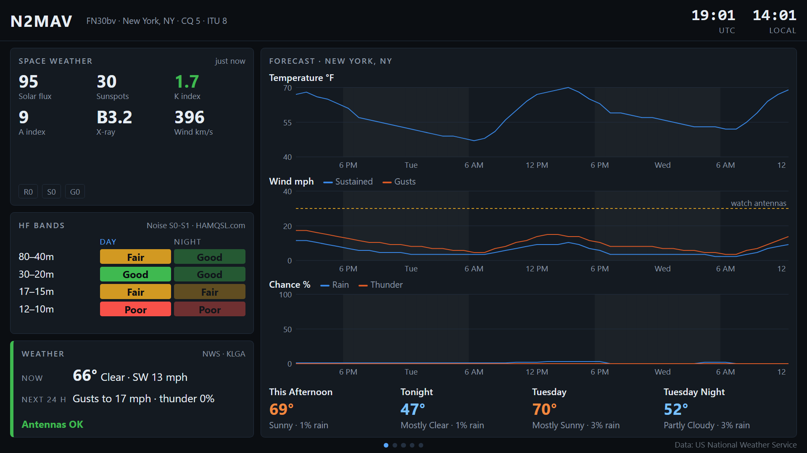
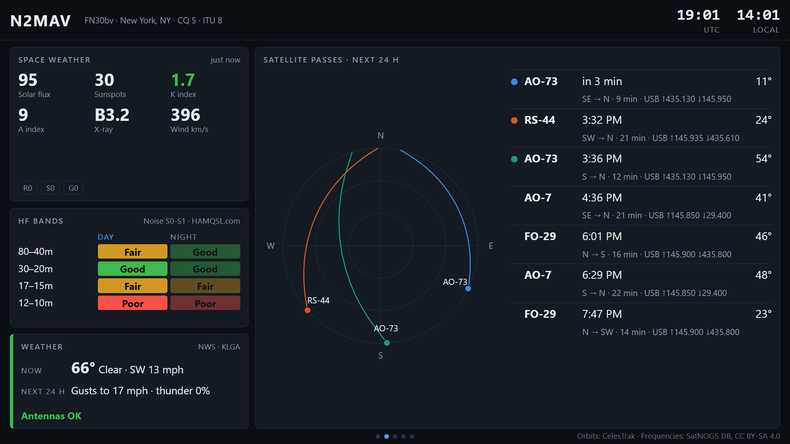
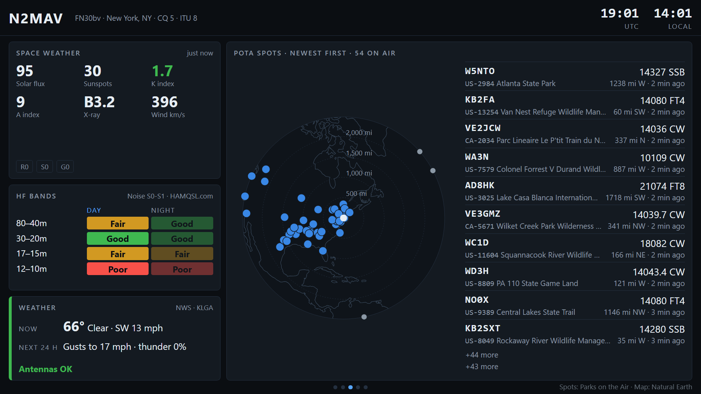
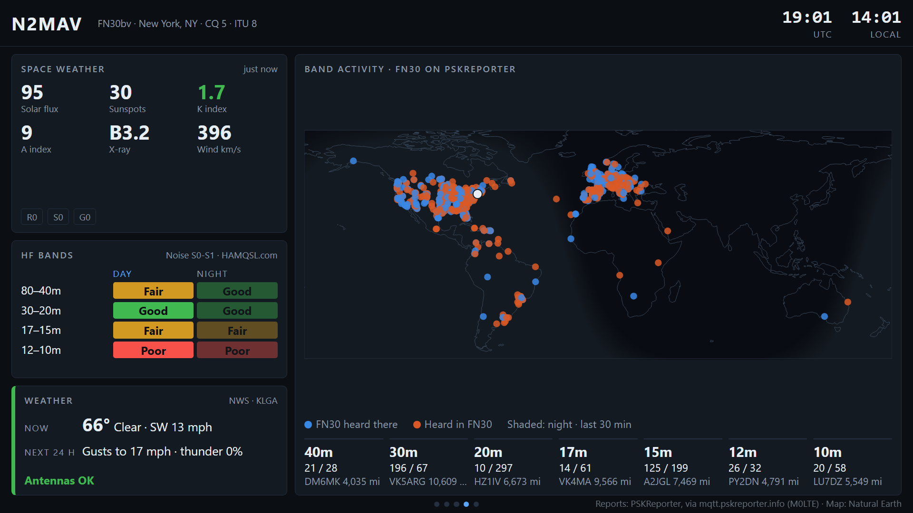
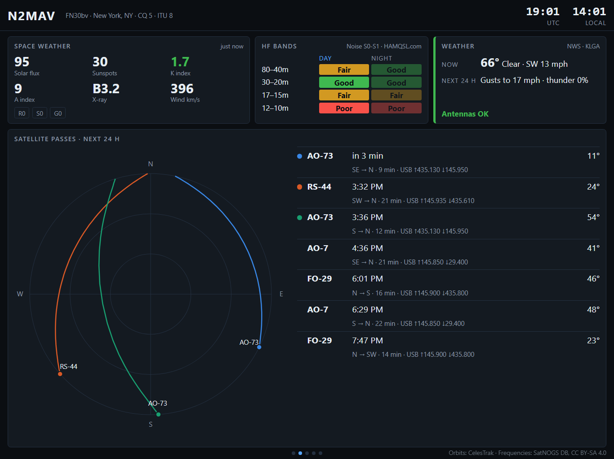
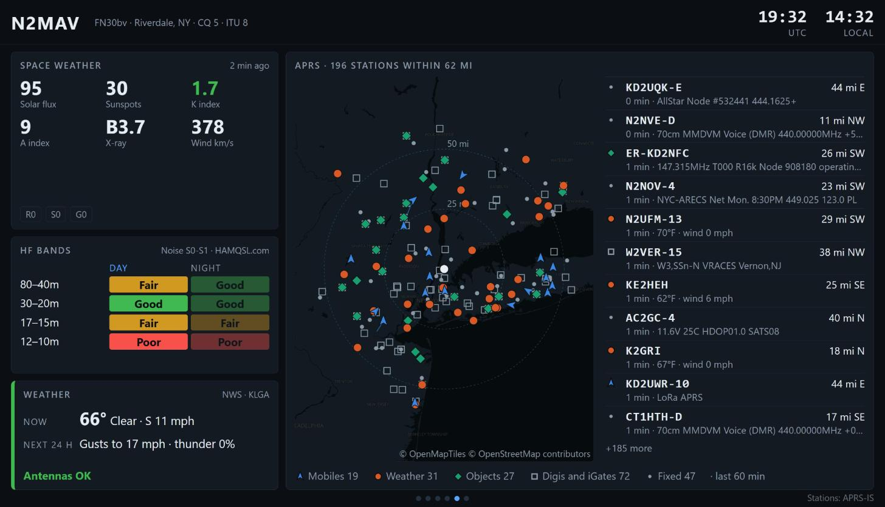
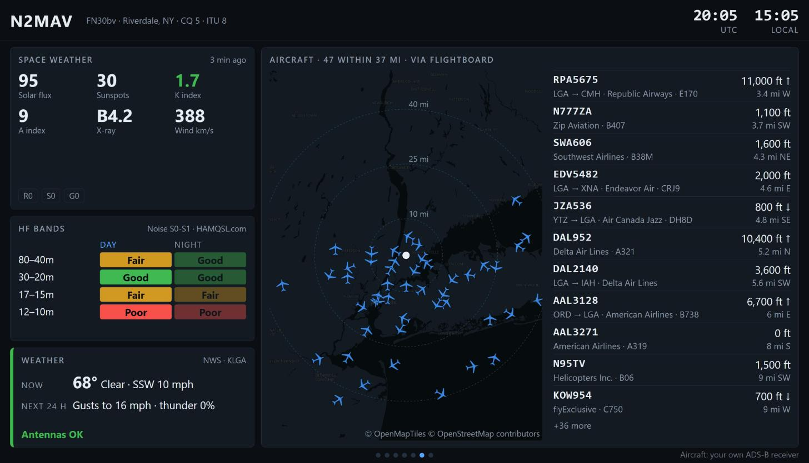

# 📻 ShackWall

A ham radio information display for the shack: space weather, band conditions,
satellite passes, POTA spots, PSKReporter, weather, APRS, aircraft and
ships, on any screen that can open a web page. That means an iPad, a TV you cast
to, or a Raspberry Pi plugged into a monitor.

> **Status: early.** The page layout, clocks, live space weather from NOAA, HF
> band conditions from HAMQSL, US weather with antenna warnings from the
> National Weather Service, amateur satellite passes, POTA spots, PSKReporter
> band activity, APRS and aircraft from your own ADS-B receiver work. Ships
> are still to come.

## What it looks like

On a 1080p TV: the column on the left stays put, and the big panel takes
turns between the forecast, satellite passes, POTA spots, band activity, APRS,
aircraft and space weather alerts.



| | |
|---|---|
|  |  |
| Satellite passes | POTA spots |
|  |  |
| Band activity from PSKReporter | On an iPad |





## Install

You need an always-on Linux machine on your network (a Raspberry Pi 4 or 5, or
any PC) with Python 3.10 or newer. The steps assume you clone into your home
directory as `~/ShackWall`.

1. Get the code:
   ```bash
   sudo apt install -y git python3-venv && cd ~ && git clone https://github.com/gonzalu/ShackWall.git
   ```
   On Ubuntu, if apt asks for a versioned package, install that instead, for
   example `python3.14-venv`.
2. Create its Python environment:
   ```bash
   cd ~/ShackWall && python3 -m venv .venv && .venv/bin/pip install -r backend/requirements.txt
   ```
3. Copy the example settings and fill in your callsign, grid and time zone:
   ```bash
   cd ~/ShackWall && cp shackwall.env.example shackwall.env && nano shackwall.env
   ```
   Fill in `CONTACT_EMAIL` too. It goes into the User-Agent of every request,
   so a data provider who sees a problem can write to you instead of blocking
   you, and the National Weather Service asks for it.
4. Try it by hand:
   ```bash
   cd ~/ShackWall && .venv/bin/uvicorn backend.main:app --host 0.0.0.0 --port 8092
   ```
   Open `http://<that machine's address>:8092/` on any screen on your network.
   The first minute fills in as each source answers. Press Ctrl+C to stop.
5. Run it at boot. This fills your user name into the service file, installs
   it and starts it:
   ```bash
   cd ~/ShackWall && sed "s#YOUR-USER#$USER#g" shackwall.service | sudo tee /etc/systemd/system/shackwall.service >/dev/null && sudo systemctl daemon-reload && sudo systemctl enable --now shackwall
   ```
   Check it is running:
   ```bash
   systemctl status shackwall --no-pager
   ```

On an iPad, open the page in Safari, tap Share, then **Add to Home Screen**. It
then opens full screen like an app.

### Keeping it up to date

```bash
cd ~/ShackWall && git pull && .venv/bin/pip install -r backend/requirements.txt && sudo systemctl restart shackwall
```

Screens that are already open reload themselves when the page files change.

## The layout

A column on the left always shows the numbers you check at a glance: space
weather, band conditions and local weather. The large panel on the right cycles
through one subject at a time every 20 seconds. On a touch screen, tap it to
move on. On a squarer screen like an iPad, the column moves across the top.

The HF bands panel shows N0NBH's Good / Fair / Poor call for each pair of
bands, by day and by night. The half of the day it is at your station is
bright and the other is dimmed; ShackWall works out where the sun is from
your position, so it switches at your own sunrise and sunset.

The weather panel shows the latest observation from the nearest reporting
station, the strongest gust and the highest chance of thunder forecast for the
next 24 hours, and what that means for your antennas:

- **Lower antennas** during a tornado, severe thunderstorm, extreme wind, high
  wind, hurricane or tropical storm warning, or when gusts reach
  `WIND_LOWER_MPH` (45 by default).
- **Watch antennas** during a matching watch or a wind advisory, when gusts of
  `WIND_WATCH_MPH` (30 by default) are forecast, or when the chance of thunder
  reaches 30%.
- **Antennas OK** otherwise.

Set the two wind limits in `shackwall.env` for what your antennas can take.

The large panel takes turns between these pages:

- **Forecast:** three 48-hour charts (temperature; wind and gusts against your
  `WIND_WATCH_MPH` line; chance of rain and of thunder), with nights shaded,
  the next four forecast periods underneath, and any active NWS alerts across
  the top.
- **Satellite passes:** a sky plot of the next three passes (the horizon is
  the rim, straight overhead the middle, north at the top) beside the next
  seven, each with its direction, length and frequencies. While a satellite
  is up, a ringed dot shows where it is.
- **POTA spots:** activators on the air now, newest first, on a map centred
  on your station beside the list. The map keeps true distance and direction
  from you, so the bearing to a park is the way you'd point a beam; rings mark
  every 1,000 miles. Activators who have signed off (QRT) are left out.
- **Band activity:** a world map of every PSKReporter report in the last 30
  minutes with a sender or a receiver in your 4-character grid square: blue
  where stations near you were heard, orange the stations heard near you.
  Night is shaded, and its soft edge is the gray line. Under the map, each
  band's counts and its farthest station. It shows where the bands are open
  from your area whether or not your own rig is on.
- **APRS:** every station heard within `APRS_RANGE_KM` (100 km by default) in
  the last hour, on a live map beside the newest ones. Mobiles are blue arrows
  pointing the way they are going, with a trail; weather stations are orange
  dots; objects such as repeaters and nets are green diamonds; digipeaters
  and iGates are grey squares. The map is OpenStreetMap from OpenFreeMap, as
  on FlightBoard's dashboard, fetched by the browser showing the page. Add
  `?map=static` to the page's address to keep a screen from fetching any map:
  the stations are then drawn on a plain background.
- **Aircraft:** what your own ADS-B receiver sees, on the same map, nearest
  first, with altitude (↑ climbing, ↓ descending) and, through FlightBoard,
  the route, airline and aircraft type. Set `AIRCRAFT_URL` to FlightBoard's
  `/api/aircraft` or to your receiver's `aircraft.json`; without it the page
  is left out. While it is showing, the screen refreshes every 5 seconds.
- **Space weather alerts:** NOAA's alerts, warnings and watches from the last
  24 hours.

ShackWall connects to APRS-IS receive-only, as your callsign with `-SW` after
it and passcode -1, the way APRS-IS documents for clients that never
transmit; you don't need a passcode. Set `APRS_SERVER` to your region's
server (see `shackwall.env.example`).

Passes are worked out on the backend from the orbits, for the ISS, SO-50,
AO-27, AO-123, RS-44, AO-7, FO-29, JO-97, AO-73 and AO-91 unless you list
others by NORAD number in `SATELLITES`. Passes that never climb above
`SAT_MIN_ELEVATION` (10° by default) are left out.
There is no live lightning map: the one community network, Blitzortung, only
shares its data with people who run a detector. Weather is US-only, because it
comes from the National Weather Service.

Everything is sized relative to the screen, so 720p, 1080p and 4K show the same
layout. The smallest text is about 12 mm tall on a 55" TV, at any resolution.

## How it works

A small Python backend runs on an always-on Linux machine on your network. It
fetches each data source on that source's own schedule, caches the results and
serves one web page. Every screen in the house reads from the backend, never
from the data providers directly. Each provider sees one polite client no
matter how many screens are open, and any API keys stay on the server.

The page scales itself to the screen: 720p, 1080p and 4K TVs, and tablets.

## Inspiration

Inspired by LB0FI's video
[I made a HAM RADIO INFO DISPLAY!](https://youtu.be/c65HqK48vzQ), an
ESP32-P4 panel built with Claude. ShackWall is an independent project and isn't
affiliated with LB0FI or Elecrow.

## Data sources

Each source is used within its published terms. ShackWall identifies itself
in every request and caches politely.

| What | Source | Terms in short |
|---|---|---|
| Solar flux, K/A index, alerts | [NOAA SWPC](https://www.swpc.noaa.gov/) | US government data |
| Band conditions | [HAMQSL.com](https://www.hamqsl.com/solar.html) by N0NBH | Credit asked for, shown on the panel; fetched once an hour, kept on disk across restarts |
| Path predictions | [VOACAP](https://www.voacap.com/) (run locally) | Open source |
| Satellite orbits | [CelesTrak](https://celestrak.org/) | No more than one download per 2 hours, failures included; kept on disk and refreshed every 6 |
| Satellite frequencies | [SatNOGS DB](https://db.satnogs.org/) | CC BY-SA 4.0, credited on the page; one request a day, kept on disk |
| POTA spots | [Parks on the Air](https://pota.app/) | No published API terms; read every 2 minutes, one client for all screens; no POTA logo |
| Reception reports | [PSKReporter](https://pskreporter.info/), via [mqtt.pskreporter.info](https://www.mqtt.pskreporter.info/) by Tom M0LTE | Live feed, no account or polling; one connection subscribed to your grid square only |
| Weather and alerts | [US National Weather Service](https://www.weather.gov/documentation/services-web-api) | Open data, free for any use; each product fetched only as often as its Cache-Control says it changes |
| APRS stations | [APRS-IS](https://www.aprs-is.net/) | One receive-only connection, filtered on the server to your range; not aprs.fi, whose terms only allow fetching while someone is looking |
| APRS map | [OpenFreeMap](https://openfreemap.org/), OpenStreetMap data | No key or limits; © OpenMapTiles © OpenStreetMap contributors, shown on the map |
| Aircraft | Your own ADS-B receiver: [FlightBoard](https://github.com/gonzalu/FlightBoard)'s API or any dump1090/readsb `aircraft.json` | Your data, on your network; read every 5 seconds |
| Ships | [aisstream.io](https://aisstream.io/) | Free key; server-side only |
| World map | [Natural Earth](https://www.naturalearthdata.com/) 1:110m land, as [world-atlas](https://github.com/topojson/world-atlas) TopoJSON | Public domain; world-atlas is ISC |

SOTA spots aren't included. The SOTA API's terms don't allow software written
with AI to connect without the SOTA Management Team's approval.

## Licence

[Apache-2.0](LICENSE).
